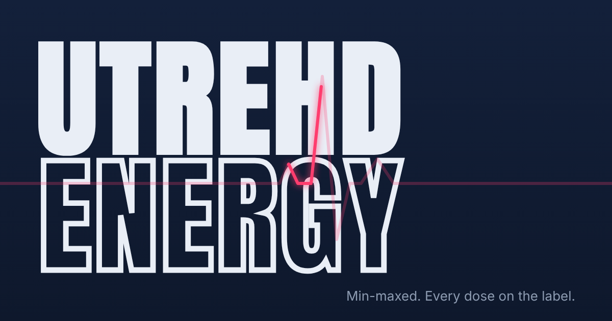

# UTREHD Energy

A home-mixed energy and vitamin drink, min-maxed. The page shows two versions (Everyday and Hardcore session), what goes in the bottle, and every ingredient checked against its daily max, with what it does short and long term.

**Live page:** https://utrehd.github.io/FoogyDude-Energy/

## Files

- `index.html` — the whole site in one file
- `utrehd-energy.svg` — animated hero image
- `utrehd-energy.png` — static image for link previews
- `.nojekyll` — tells GitHub Pages to serve the files as they are

## GitHub Pages

The site is served from the root of the repository. In **Settings → Pages**, the source is **Deploy from a branch**, with the branch that holds these files and `/ (root)`.

Not medical advice. Not for under-18s, pregnancy or breastfeeding.
