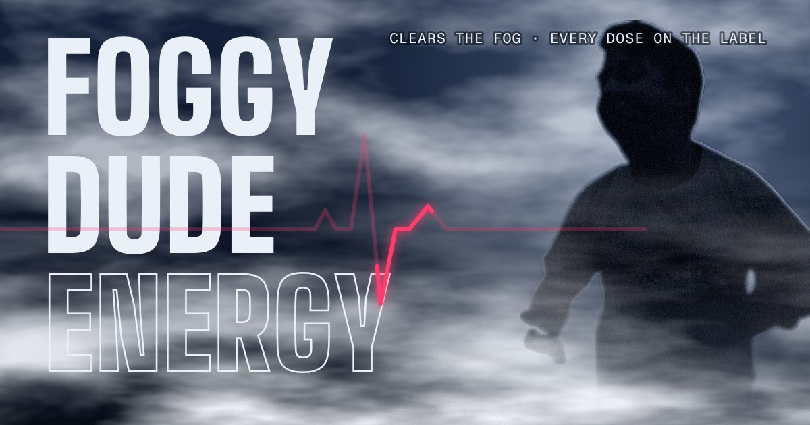

# Foggy Dude Energy

Clears the fog. A home-mixed energy and vitamin drink, min-maxed. The page shows two versions (Everyday and Hardcore session), what goes in the bottle, and every ingredient checked against its daily max, with what it does short and long term.

**Live page:** https://utrehd.github.io/FoogyDude-Energy/

## Files

- `index.html` — the whole site in one file, including the fog background (drifting layers with scroll parallax) and the Foggy Dude figure
- `foggy-dude.webp` — the Foggy Dude: Samuel's photo cut out and turned into a dark, grainy silhouette for the fog
- `foggy-dude-energy.svg` — animated hero image
- `foggy-dude-energy.jpg` — still image for link previews
- `.nojekyll` — tells GitHub Pages to serve the files as they are

## Type

- **Big Shoulders Display** for the wordmark and headings
- **Fragment Mono** for everything else, a free monospace based on Helvetica. It's a stand-in for the Swiss monos (Suisse Int'l Mono, ABC Diatype Mono), which need a paid web license. The font stack already lists them, so self-hosting a licensed copy with `@font-face` is enough to swap.

## GitHub Pages

The site is served from the root of `main`. In **Settings → Pages**, the source is **Deploy from a branch**, `main`, `/ (root)`.

Not medical advice. Not for under-18s, pregnancy or breastfeeding.
